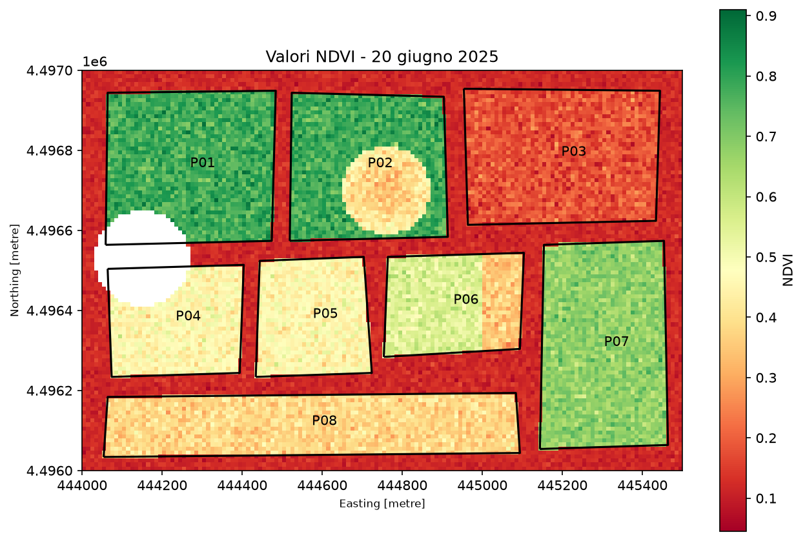
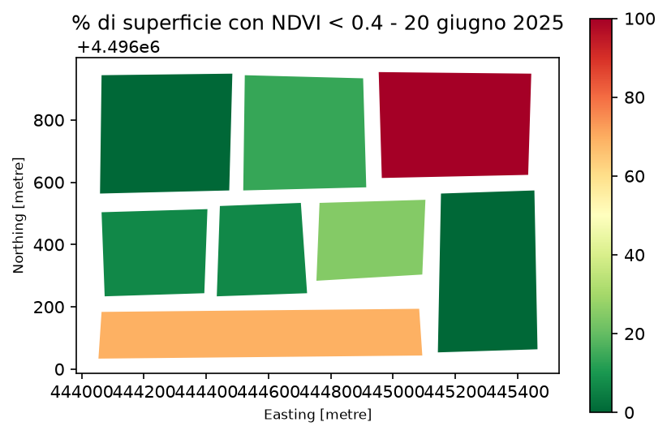

# Monitoraggio NDVI per particella – azienda agricola della Nurra

## In breve
Analisi dell'NDVI Sentinel-2 del 20 giugno 2025 su 8 particelle di un'azienda agricola della Nurra, per pianificare le visite dell'agronomo in campo.
Solo la P02 (mais) richiede un sopralluogo: ha una zona di NDVI basso assente nell'altro campo di mais. I valori bassi di grano duro, carciofo e oliveto sono invece normali per il periodo. È emersa anche una superficie dichiarata sovrastimata del 12% (P07).

## Dati
Vengono forniti due file simulati:
- particelle_azienda.geojson: i confini delle 8 particelle, esportati dall’app aziendale, con id_particella, coltura e superficie_dichiarata_ha;
- ndvi_2025-06-20.tif: l’NDVI calcolato da Sentinel-2 il 20 giugno 2025, con una risoluzione di 10 m.

## Workflow
1. Caricamento ed esplorazione dei dataset: controllo del CRS, dimensione dei pixel e valori nodata.
2. Riproiezione del CRS del file vettoriale.
3. Calcolo della superficie per appezzamento e confronto con la superficie dichiarata.
4. Esplorazione e visualizzazione del raster: visualizzazione del NDVI nei vari appezzamenti e identificazione dei pixel nodata.
5. Calcolo del NDVI medio sulla particella P04: valutazione dell'effetto della presenza di nuvole sull'NDVI.
6. Calcolo di NDVI medio, % di nuvole e % di NDVI sotto la soglia di 0.4 per ogni particella.
7. Salvataggio ed esportazione del report finale: file .gpkg, tabella csv e mappa finale.
8. Interpretazione agronomica e raccomandazioni: i valori di NDVI bassi sono stati valutati in base alla fase della coltura nel periodo analizzato (raccolta, riposo vegetativo, struttura della chioma) e confrontando tra loro le particelle con la stessa coltura.

## Risultati

Tabella risultati

id_particella |coltura     |NDVI_medio  |%_sotto_04   | %_nuvole
|---|---|---|---|---|
P01	          |mais	       |0,780	    |0,0         |8,2
P02	          |mais	       |0,676	    |13,8        |0,0
P03	          |grano duro  |0,180       |100,0       |0,0
P04	          |vite	       |0,460	    |6,8         |17,8
P05	          |vite	       |0,459	    |6,6         |0,0
P06	          |carciofo    |0,494	    |24,6        |0,0
P07	          |erba medica |0,678	    |0,0         |0,0
P08	          |oliveto	   |0,380	    |69,5        |0,0

## Conclusioni per il cliente
- La particella P02 coltivata a mais presenta valori anomali di NDVI concentrati in un'unica zona e richiede un sopralluogo immediato.
- I valori NDVI per la particella P04 dovrebbero essere rivalutati utilizzando una nuova immagine, data l'alta presenza di nuvole nel raster utilizzato (17,8%).
- È necessario aggiornare le informazioni sulla superficie dichiarata della particella P07 che supera del 12% quella misurata.
- Le restanti particelle presentano valori compatibili con il tipo di coltura e il periodo analizzato.

## Strumenti
Python · geopandas · rasterio · pandas · matplotlib